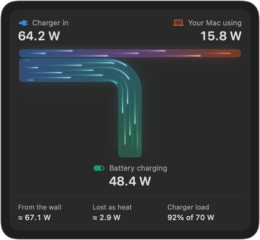
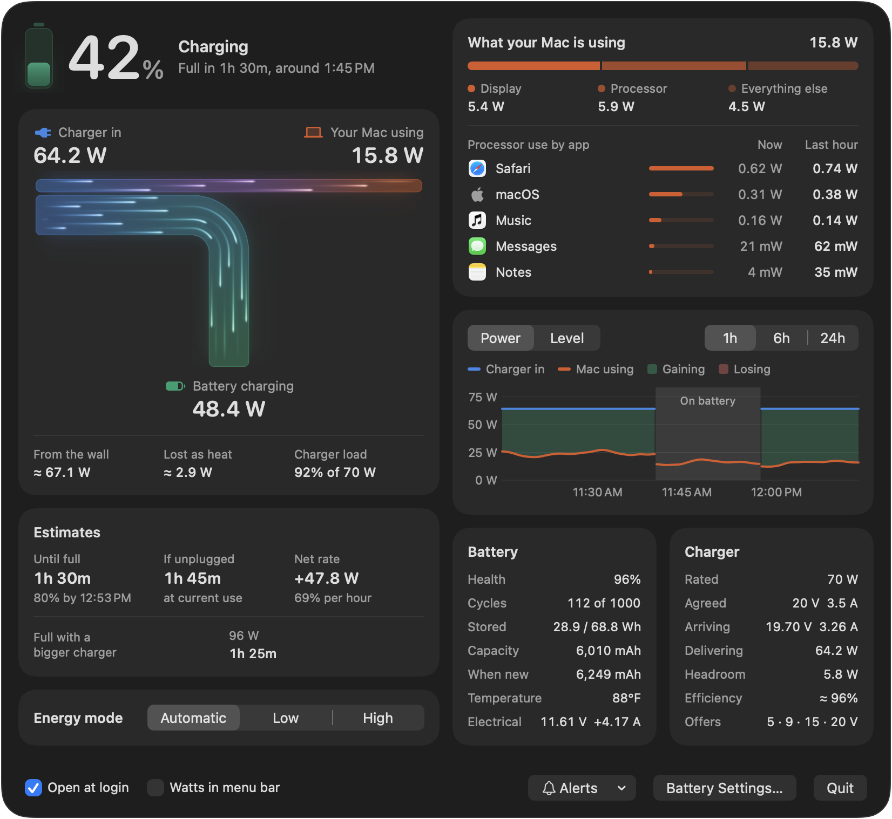
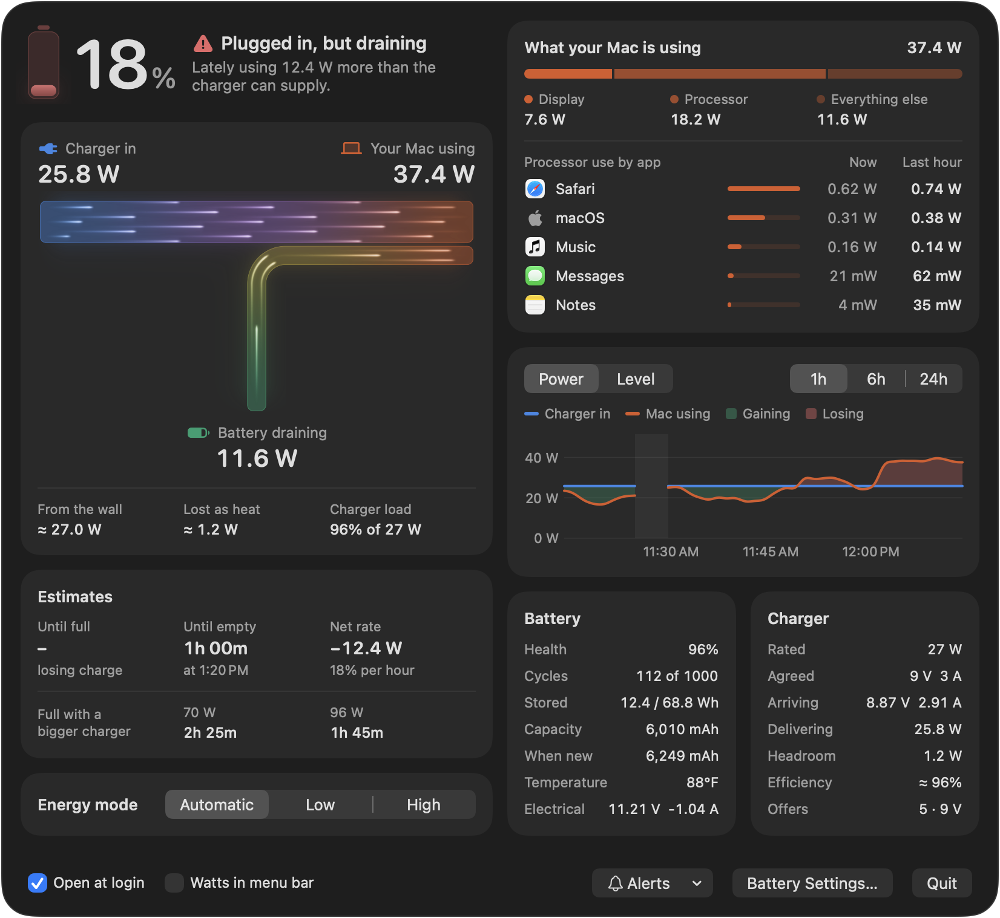
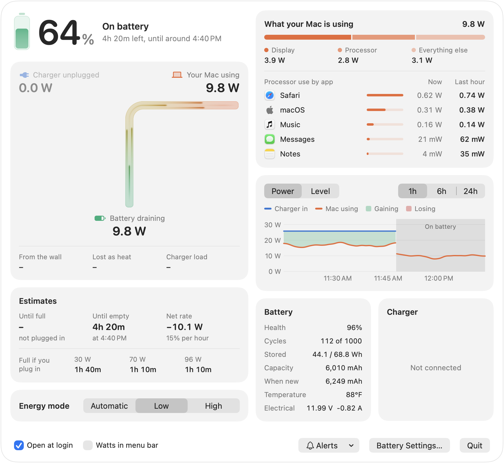
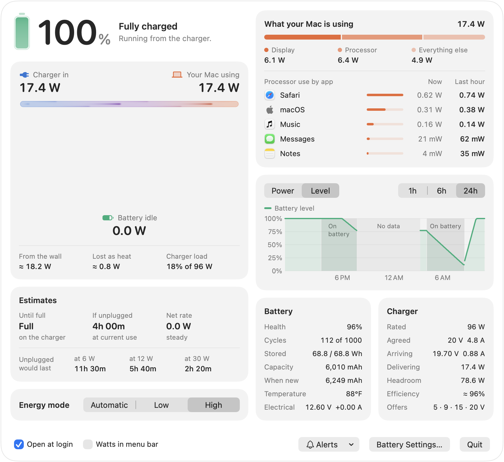

# Joule

A menu bar battery app for Mac that shows where the power is actually going: what the charger delivers, what your Mac uses, and what's left for the battery.

[](https://github.com/zachjacobs/joule/actions/workflows/ci.yml)
[](https://github.com/zachjacobs/joule/releases/latest)

<p align="center"></p>

## Download

1. Get the zip from the [latest release](https://github.com/zachjacobs/joule/releases/latest) and unzip it.
2. Move **Joule** to Applications and open it.
3. Joule isn't notarized by Apple, so macOS blocks it the first time. Go to **System Settings → Privacy & Security**, scroll down, and choose **Open Anyway**.

Needs a Mac with Apple silicon and macOS 15 or later. It has only been tested on a MacBook Pro with M4 Pro running macOS 27.

To hide Apple's battery icon, use **System Settings → Menu Bar**.

## What it looks like

Sample data throughout.

### Charging



### Plugged in, but draining

macOS can say "charging" while the battery goes down, because the charger can't keep up. Joule says so, and shows how much a bigger charger would help.



### On battery

Light mode, with Low Power on.



### Fully charged

With a day of battery level. Time on battery and gaps in the data are shaded.



## What it does

- **Power flow.** Ribbon width follows watts. The streaks run from source to destination, and the battery ribbon changes sides when it starts draining.
- **Estimates.** Time to full or empty, how long you'd last unplugged, and what a bigger charger would do. When your load is uneven you get a range instead of a falsely exact time.
- **What's using power.** Display, processor and everything else, plus your top apps ranked over the last hour.
- **History.** Power or level over 1, 6 or 24 hours, filled green while gaining and red while losing.
- **Alerts.** Draining while plugged in, the charger dropping out, and reaching a charge level you pick.
- **Details.** Health, cycles, temperature, and what your charger negotiated.
- **Energy mode.** Automatic, Low or High. macOS asks for an administrator password to change it.

Joule makes no network connections. History stays in `~/Library/Application Support/Joule`.

## How far to trust the numbers

| Reading | Where it comes from |
| --- | --- |
| Charger and battery watts | Live sensors |
| What your Mac uses | Charger watts minus battery watts |
| Wall draw and heat loss | Charger watts plus macOS's own loss estimate |
| Display and processor | Undocumented Apple sensors, so treat the split as approximate |
| Per-app watts | Processor energy for processes running as you. Excludes the display, radios and system services running as root |
| Time estimates | Joule's own charging model, using roughly a 3-minute average |

## Build it yourself

You need the Xcode command line tools, not Xcode.

```bash
Joule/build.sh
```

That makes `Joule/Joule.app`. Run the checks with:

```bash
Joule/Joule.app/Contents/MacOS/Joule --selftest
```

Screenshots come from `--snapshot <file> --scene <charging|draining|battery|full>`, with optional `--light`, `--24h`, `--level`, and `--flow` for the animation.

## Releasing

Push a version tag. GitHub Actions builds, tests and publishes the download.

```bash
git tag v1.2.3 && git push origin v1.2.3
```
